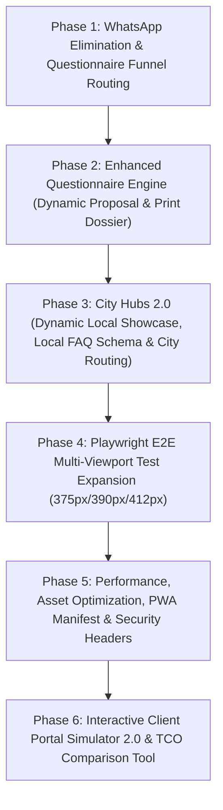

# Continuous Autonomous Goal Marathon Plan: Samen Online Conversion & Experience Platform

## Executive Summary
This autonomous marathon plan executes structured turn-by-turn enhancements for the Samen Online conversion platform.
Every phase is independently planned, executed, verified with automated unit tests & Playwright tests, and committed with zero regressions.

---

### Phase 1 — WhatsApp Elimination & Questionnaire Funnel Routing
- **Objective:** Strictly respect the user requirement to omit all WhatsApp conversion buttons and route visitors to the interactive questionnaire (`/vragenlijst` & `#website-vragenlijst`).
- **Changes:**
  - `src/components/PriceEstimatorCalculator.tsx`: Replace "Stuur Direct via WhatsApp naar Kenan" with "Start Direct Vragenlijst (2 min) met Gekozen Specificatie" routing directly to `/vragenlijst?pakket=...&addons=...`.
  - `src/components/ExpressDeliveryCallout.tsx`: Replace "Spoed via WhatsApp" with "Start Spoed Intake Vragenlijst" routing to `/vragenlijst?spoed=true`.
  - `src/components/WebsiteCopilotWidget.tsx`: Replace WhatsApp prefill clicks with direct intake routing into the questionnaire prefilled with the copilot recommendation.
  - Verification in unit test suite (`tests/test_site_verification.py`).

### Phase 2 — Enhanced Questionnaire Engine (Dynamic Proposal & Print Dossier)
- **Objective:** Turn `/vragenlijst` into an ultra-high converting intake machine.
- **Changes:**
  - Deepen the questionnaire result screen: Instant project breakdown, estimated timeline, recommended tech stack (Next.js + Tailwind + Vercel/Cloudflare Edge), and printable proposal dossier (`window.print()`).
  - Read URL query parameters (`pakket`, `stad`, `spoed`, `addons`) to auto-prefill the questionnaire.
  - Automated tests validating prefill behavior and dossier generation.

### Phase 3 — City Hubs 2.0 (Dynamic Local Showcase, Local FAQ Schema & City Routing)
- **Objective:** Maximize local Google search authority across 12 Dutch cities (`/locaties/[stad]`).
- **Changes:**
  - Deepen each city page with localized case studies, region-specific portfolio highlights, local landmarks, and localized Schema.org `LocalBusiness` / `FAQPage` JSON-LD markup.
  - Direct CTA from each city page to `/vragenlijst?stad=[stad]` pre-selecting the city in the intake form.
  - Automated verification of Schema.org syntax and status 200 for all 12 cities.

### Phase 4 — Playwright E2E Multi-Viewport Test Expansion (375px/390px/412px)
- **Objective:** Guarantee flawless mobile UX and zero horizontal scroll overflow across all real device widths.
- **Changes:**
  - Expand `tests/test_mobile_viewports.py` to test complete questionnaire progression on 375px, 390px, and 412px.
  - Test all 12 city hubs for zero horizontal overflow (`scrollWidth <= clientWidth`).
  - Verify cart drawer and printable dossiers on mobile devices.

### Phase 5 — Performance, Asset Optimization, PWA Manifest & Security Headers
- **Objective:** Maximize Core Web Vitals (LCP < 0.8s, CLS = 0, INP < 50ms) and establish PWA readiness.
- **Changes:**
  - Web App Manifest audit (`manifest.json` / `manifest.webmanifest`), icon definitions, theme colors.
  - Security headers in HTML meta tags and static export configurations.
  - Preload optimization for critical assets.

### Phase 6 — Interactive Client Portal Simulator 2.0 & TCO Comparison Tool
- **Objective:** Overcome visitor skepticism with interactive proof tools.
- **Changes:**
  - Client Portal Simulator: 5-day transparent onboarding timeline.
  - TCO Comparison Tool: WordPress/Wix vs Modern Next.js stack cost and maintenance calculator with exportable PDF report.
