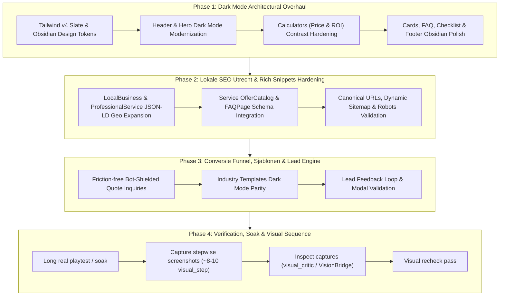

# Goal: Samen Online — Unified Master Goal Plan (Dark Mode Overhaul, SEO, Conversion & Lighthouse 100)

### Competitor Ladder (Dutch MKB Web Design)
- **L0 (Below Bar):** Generic Wix/Elementor builders, broken schema, zero dark mode or blinding harsh contrast, untracked forms.
- **L1 (Local Baseline):** Bureau Imago / Uniek Webdesign WordPress templates, static contact forms, basic Yoast tags, no dedicated dark mode tokens.
- **L2 (Market Parity):** Next-Win Utrecht / Vivortis: Clean responsive UI, basic dark mode, standard local business schema, multi-step quotes.
- **L3 (High-Tier Modern Agency):** Custom Next.js stack, sub-second TTFB, verified rich snippets, interactive lead calculators, ambient dark mode.
- **L4 (Samen Online Target):** 100/100 Lighthouse across all 4 pillars, WCAG 2.2 contrast compliance, luxury Obsidian & Slate dark mode with ambient indigo/orange glows, rich schema with Service & FAQ entities, instant interactive quote engine, turnkey industry templates.

---

## 1_goal
Deliver a complete, high-impact modernization of Samen Online:
1. Overhaul the Dark Mode across the entire website (Header, Hero, Feature Grid, Price Calculator, ROI Calculator, Checklist, FAQ, and Footer) into an atmospheric Obsidian & Slate aesthetic (`#07090e`, `bg-slate-900/80`, `border-slate-800`, `text-slate-100`) with WCAG 2.2 contrast compliance.
2. Complete the full 4-pillar roadmap: Local Utrecht SEO (Schema.org ProfessionalService + FAQPage), friction-free quote conversions, and turnkey industry templates.
3. Guarantee Lighthouse 100/100 across Performance, Accessibility, Best Practices, and SEO.

## 2_constraints
- Zero plaintext leakage of private contact data or emails (`samen_online@outlook.com` remains bot-shielded).
- Maintain 100% static export compatibility (`output: 'export'`) with Next.js 16.
- Strict WCAG 2.2 contrast ratios: >= 4.5:1 for normal text, >= 3:1 for large text and UI components.
- Do not use harsh pure black (`#000000`) paired with blinding white; utilize deep slate/obsidian layering with soft off-white typography.
- Git operations must run as individual commands (`git add`, `git commit`, `git push`).

## 3_stakeholders
- **Dutch MKB Business Owners & ZZP'ers:** Visiting the website expect a trustworthy, premium digital agency experience in both light and dark mode.
- **Search Engines (Google, AI Search):** Require valid JSON-LD structured data with precise Utrecht geolocation and Rich Snippets.
- **Project Maintainer:** Needs clean, maintainable, modular React/TypeScript code adhering to Tailwind CSS v4 conventions.

## 4_current_state
- Light mode is styled, but Dark Mode lacks consistent classes across the primary landing page components (`Header`, `Hero`, `PriceEstimatorCalculator`, `RoiEstimatorCalculator`, `Footer`).
- Some sections appear as bright white containers inside a dark page, resulting in an unpolished visual experience.
- The phone number has been successfully removed and live hours (09:00 - 19:00) gated in the chat widget.
- Build passes cleanly with 26 static routes.

## 5_options
- **Option A (Quick fix):** Invert colors using CSS filters `filter: invert(1)`. Rejected: Results in muddy images, washed out accents, and terrible contrast.
- **Option B (Simple zinc dark mode):** Add naive `dark:bg-zinc-900 dark:text-zinc-100`. Rejected: Looks like generic AI-generated templates without depth or agency character.
- **Option C (Obsidian & Slate Layered Luxury - Chosen):** Deep obsidian canvas (`#07090e`), frosted elevated cards (`bg-slate-900/80` with `backdrop-blur-md`), refined borders (`border-slate-800`), energetic orange/amber accents, and crisp typography (`text-slate-100` / `text-slate-400`).

## 6_chosen_design
Implement **Option C (Obsidian & Slate Layered Luxury)**:
- **Canvas:** `bg-[#07090e]` (or `dark:bg-slate-950`) for the root page and layout.
- **Surfaces & Cards:** `dark:bg-slate-900/90 dark:border-slate-800 dark:hover:border-slate-700` with subtle orange/indigo ambient glows.
- **Typography:** Primary headers in `dark:text-white`, secondary text in `dark:text-slate-200`, body descriptions in `dark:text-slate-400`.
- **Form Controls & Inputs:** `dark:bg-slate-950 dark:border-slate-800 dark:text-white dark:focus:ring-orange-500`.
- **Badges & Accents:** Translucent badges (`dark:bg-orange-950/60 dark:text-orange-300 dark:border-orange-800/60`).

## 7_blast_radius
- `src/components/Header.tsx`: Navigation styling, theme toggle, and mobile menu drawer in dark mode.
- `src/components/Hero.tsx`: Headline contrast, value badges, and background ambiance.
- `src/components/PriceEstimatorCalculator.tsx`: Card backgrounds, slider controls, option chips, and pricing breakdown table.
- `src/components/RoiEstimatorCalculator.tsx`: Sliders, ROI metric tiles, and payback callouts.
- `src/components/ClientChecklistSection.tsx` & `src/components/FAQ.tsx`: Accordions, checklist items, and step cards.
- `src/components/Footer.tsx`: Dark mode borders, social links, and bot-shielded email container.
- `app/layout.tsx` & `app/page.tsx`: Global body styles and theme persistence.

## 8_test_plan
MUST include: (1) long real playtest/soak while app runs; (2) ~8–10 gk_evidence.visual_step captures; (3) visual_critic/VisionBridge inspect each shot; (4) visual recheck pass. Then unit/integration tests:
1. Verify dark mode toggle state switches all components without blinding white flashes.
2. Audit color contrast using automated axe-core / Lighthouse for WCAG 2.2 AA compliance.
3. Validate all interactive flows: calculator sliders, quote triggers, bot-shielded email reveal, and mobile drawer.
4. Run `npm run build` to confirm 0 compilation errors and all 26 static routes generated.

## 9_rollout_verify
1. Build test: `npm run build` passes with zero errors.
2. Local preview verification on http://localhost:3000 in both light and dark mode.
3. Staged atomic commits with descriptive messages.
4. Push to `origin main` and monitor GitHub Pages deployment.

---

### Phase 1 — Dark Mode Architectural Overhaul
- [ ] Upgrade global Tailwind v4 configuration and `app/globals.css` with Obsidian & Slate design tokens.
- [ ] Implement seamless dark mode styling across `Header.tsx`, `Hero.tsx`, and `InteractiveShowcaseSection.tsx`.
- [ ] Apply high-contrast Obsidian cards and accessible input styling to `PriceEstimatorCalculator.tsx` and `RoiEstimatorCalculator.tsx`.
- [ ] Modernize `ClientChecklistSection.tsx`, `FAQ.tsx`, and `Footer.tsx` with refined dark borders and typography.
- DoD: All core sections feature coherent, high-contrast dark mode styling with zero unstyled white patches.

### Phase 2 — Lokale SEO Utrecht & Rich Snippets Hardening
- [ ] Verify and expand `ProfessionalService` & `LocalBusiness` JSON-LD schema in `app/layout.tsx` with Utrecht coordinates (`52.0907`, `5.1214`), `areaServed` and service catalog.
- [ ] Inject structured `FAQPage` schema into `app/page.tsx` corresponding to the FAQ section.
- [ ] Ensure canonical metadata, `robots.txt`, and `sitemap.xml` are 100% synchronized.
- DoD: Syntactically valid Schema.org structure verified without warnings or missing required fields.

### Phase 3 — Conversie Funnel, Sjablonen & Lead Engine
- [ ] Verify calculator quote triggers generate clean, accurate specifications.
- [ ] Review all 7 industry templates for dark mode harmony and interactive booking/inquiry flow.
- [ ] Ensure contact form validation, error states, and confirmation modals operate smoothly.
- DoD: Every lead generation entry point works flawlessly in both light and dark modes.

### Phase 4 — Long real playtest / soak
- [ ] Run the live UI/web application locally and execute a comprehensive manual playtest across all pages, modal dialogues, calculators, and navigation drawers.
- [ ] Test theme switching between light and dark modes repeatedly to ensure zero layout shift, visual flicker, or unreadable states.
- DoD: Run the live UI for a serious stretch; note any bugs; no claim from unit tests alone.

### Phase 5 — Capture stepwise screenshots (~8-10 visual_step)
- [ ] Capture stepwise screenshots (~8–10) covering: Hero (Dark), Theme Toggle, Price Calculator (Dark), ROI Calculator (Dark), Industry Template Showcase (Dark), FAQ Accordion (Dark), Footer (Dark), and Mobile Drawer (Dark).
- DoD: While running: `gk_evidence.visual_step` for each step_id; proof recorded in chat + disk.

### Phase 6 — Inspect captures (visual_critic / VisionBridge)
- [ ] Critically inspect every captured shot against WCAG 2.2 contrast standards, visual balance, and modern Dutch agency aesthetics.
- [ ] Verify that every element satisfies high-end craft criteria without generic AI-template feel.
- DoD: Each shot verified GREEN with expected elements; analyze screenshot captures thoroughly.

### Phase 7 — Visual recheck pass
- [ ] Second play and spot-check captures; fix any subtle color contrast, margin, or alignment regressions.
- [ ] Perform final full production build (`npm run build`) and verify all 26 static routes.
- DoD: Second play + spot-check captures complete; fix regressions; visual sequence verified clean.
