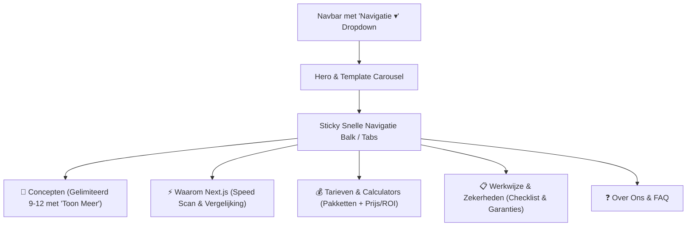

# Samen Online – Layout Redesign & Quick Navigation Plan

## Overview
De huidige homepage van Samen Online is lang geworden doordat 33 templates en meer dan 10 interactieve secties verticaal onder elkaar staan. Dit veroorzaakt scroll-moeheid ("scroll fatigue").
Dit plan introduceert een moderne SaaS layout redesign met:
1. **Snelle Navigatie Dropdown in de Navbar** ("Onderdelen ▾" / "Snel naar") met directe smooth-scroll links naar alle belangrijke secties.
2. **Template Grid "Toon Meer" / Paginering** (standaard 9–12 zichtbaar met stijlvolle "+ Meer concepten tonen" knop) om de initiële scrollhoogte met meer dan 60% te verminderen.
3. **Sticky Sub-Nav / Snelle Sectie Balk**: Directe tabs bovenaan het contentgebied (`Concepten`, `Tarieven & Calculator`, `Waarom Next.js`, `Werkwijze`, `FAQ`).
4. **Logische Sectie-ID's & Scroll-Margins**: Zodat klikken in het dropdown menu de gebruiker direct en vloeiend naar de juiste positie brengt zonder dat de sticky header de titels overlapt (`scroll-mt-24`).

---

### Phase 1 — Quick Navigation Dropdown & Sticky Section IDs
- Voeg in `src/components/Navbar.tsx` een interactief "Menu / Snelle Navigatie ▾" dropdown toe op desktop en mobiel.
- Het dropdown menu categoriseert de belangrijkste onderdelen:
  - 🎨 **Website Concepten** (`#templates-section`)
  - 💰 **Pakketten & Calculators** (`#pakketten`, `#prijs-calculator`, `#roi-calculator`)
  - ⚡ **Snelheid & CMS Vergelijking** (`#speed-audit`, `#cms-vergelijking`, `#voor-en-na`)
  - 🤝 **Werkwijze & Zekerheden** (`#hoe-het-werkt`, `#aanleveren-checklist`, `#garanties`)
  - ❓ **FAQ & Over Samen Online** (`#faq-section`, `#over-ons`)
- Rust alle secties in `app/page.tsx` uit met heldere `id="..."` en `scroll-mt-24` zodat smooth scroll exact op de juiste hoogte landt.

### Phase 2 — Template Grid Compact Weergave met 'Toon Meer'
- Implementeer in `app/page.tsx` een compacte beginweergave voor de templates grid (bijv. 9 templates = 3 rijen).
- Voeg een opvallende, elegante knop toe: *"Toon alle [X] concepten"* met teller en filterrespect.
- Zorg dat als een gebruiker filtert op categorie of zoekt, alle passende resultaten direct getoond worden.

### Phase 3 — Sticky Section Filter / Quick Jump Bar
- Voeg direct onder de Hero/Filterbar een compacte horizontale snel-navigatiebalk toe (pills/tabs) waarmee bezoekers met 1 klik naar het gewenste hoofdstuk springen.
- Toon actieve scroll-state (ScrollSpy / Intersection Observer) of duidelijke hover effecten.

### Phase 4 — Verificatie & Visual Polish
- Test mobiele weergave (dropdown sluit automatisch na klik en scrolt soepel).
- Test dark mode en light mode compatibiliteit.
- Valideer build via `next build` en pytest verificatietests.
