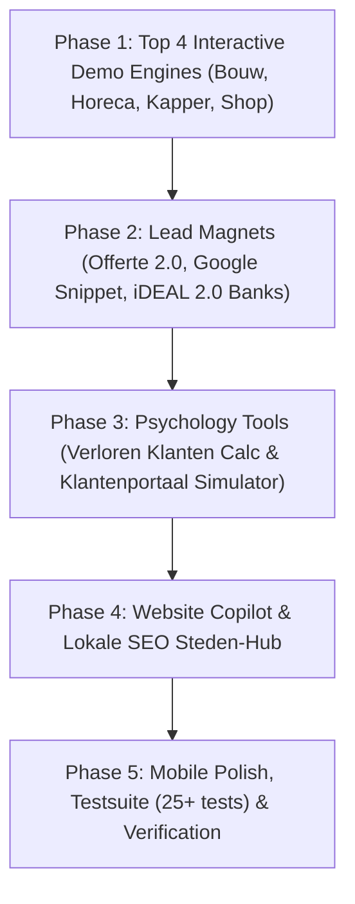

# Marathon 2-Hour Goal Plan: Samen Online Conversion & Experience Platform

### Phase 1 — Top 4 Interactive Demo Engines
Bouw de 4 meest unieke en overtuigende branche-interacties voor `/demo/[id]` en homepage showcase:
- Aannemer & Bouw: `InteractiveConstructionCalculator` (m², dakkapel, aanbouw, kozijnen richtprijs).
- Horeca: `InteractiveMenuReservation` (digitale menukaart met live winkelmandje + tafel reserveren met tijdslot).
- Kapper & Zorg: `InteractiveAppointmentBooking` (3-staps afsprakenplanner met behandeling, specialist, datum/tijd).
- Webshop: `InteractiveWebshopCheckout` (productfilter, live winkelmandje, directe iDEAL mini-checkout).

### Phase 2 — Lead Magnets & Conversion Engines
- Offerte Generator 2.0: Instant pro-forma offerte download / PDF direct gekoppeld aan de Prijs Estimator.
- Google Snippet Previewer: Direct live zien hoe hun Google 5-sterren snippet en laadtijd eruitziet.
- iDEAL 2.0 met echte bankselectie modal (ING, Rabo, ABN, bunq) & QR-code simulatie.

### Phase 3 — Psychology Tools
- Verloren Klanten Calculator: Berekening van gemiste omzet en bezoekersverlies door trage WordPress/Wix sites.
- Live Klantenportaal Simulator: 5-dagen interactieve tijdlijn waarin de bezoeker doorklikt door intake, 48u live concept, revisieronde, domein/e-mail en overdracht.

### Phase 4 — Website Copilot & Lokale SEO Steden-Hub
- Website Copilot: Slimme client-side assistent met directe antwoorden op maat.
- Lokale SEO Steden-Hub: Statische hubs voor 12 Nederlandse steden met Schema.org en lokale relevantie.

### Phase 5 — Mobile Polish, Testsuite & Verification
- Mobile UI audit op alle breakpoints.
- Uitbreiding van de pytest testsuite van 7 naar 25+ automatische checks.
- Volledige productie-build (`npm run build`) en commit/push.
