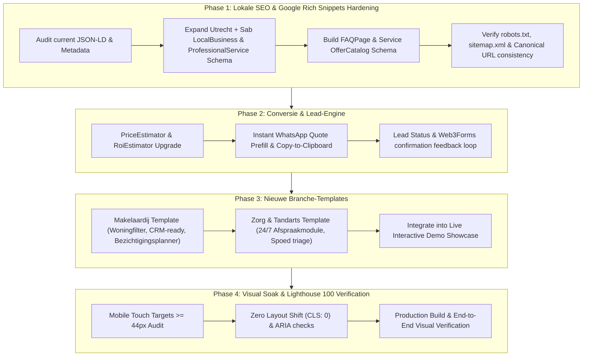

# Samen Online — Master Roadmap Plan (Unified 4-Pillar Execution)

### Competitor Ladder (Dutch MKB Web Design)
- **L0 (Below Bar):** Generic Wix/Elementor builders, broken schema, zero conversion funnel, untracked forms.
- **L1 (Local Baseline):** Bureau Imago / Uniek Webdesign WordPress templates, static contact forms, basic Yoast tags.
- **L2 (Market Parity):** Next-Win Utrecht / Vivortis: Clean responsive UI, standard LocalBusiness schema, multi-step quotes.
- **L3 (High-Tier Modern Agency):** Custom React/Next.js stack, sub-second TTFB, verified rich snippets, interactive lead calculators.
- **L4 (Samen Online Target):** 100 Lighthouse across all 4 pillars, rich schema with Service & FAQ entities, instant interactive quote engine, turnkey industry templates (Bouw, Horeca, Retail, Makelaardij, Zorg) with working lead capture & Obsidian Dark Mode harmony.

---

### Phase 1 — Lokale SEO & Google Rich Snippets Hardening
- **Objective:** Secure top local ranking signals in Utrecht and nationwide for Dutch MKB queries by injecting rich JSON-LD entities and clean technical SEO headers.
- **Scope & Files:**
  - `app/layout.tsx`: Inject comprehensive `ProfessionalService` + `LocalBusiness` JSON-LD schema with Utrecht geolocation (`52.0907`, `5.1214`), `areaServed` (Utrecht, Noord-Holland, Zuid-Holland, and nationwide SAB), opening hours, and `OfferCatalog`.
  - `app/sitemap.ts` & `app/robots.ts`: Ensure dynamic sitemap generates all canonical routes with priority and change frequencies.
  - `app/page.tsx`: Incorporate semantic `FAQPage` schema markup corresponding to the existing FAQ accordion.
- **Verification Gates:**
  - Rich Results test validity (syntactically valid Schema.org structure).
  - Clean Next.js static build without canonical or metadata warnings.

---

### Phase 2 — Conversie & Lead-Engine
- **Objective:** Transform passive visitors into qualified leads with friction-free quote generation and instant WhatsApp routing.
- **Scope & Files:**
  - `components/PriceEstimatorCalculator.tsx`: Add 1-click "Stuur specificatie via WhatsApp" with pre-filled scope and calculated estimate, plus instant clipboard copy for email quotation.
  - `components/RoiEstimatorCalculator.tsx`: Enhance conversion projection breakdown and direct lead CTA.
  - `components/ContactForm.tsx`: Ensure Web3Forms submission handles loading states, error fallback, and clear confirmation modals.
- **Verification Gates:**
  - Test calculation logic across all tier combinations.
  - Verify WhatsApp URL encoding correctly encapsulates selected features and price range.

---

### Phase 3 — Nieuwe Branche-Templates
- **Objective:** Expand the demo showcase with two high-margin Dutch sectors: Makelaardij (Vastgoed) and Zorg & Mondzorg (Tandarts / Fysiotherapie).
- **Scope & Files:**
  - `components/demo-showcase/MakelaardijTemplate.tsx`: Interactive real estate showcase with property filter (prijs, kamers, status: 'Beschikbaar' / 'Onder bod'), interactive object card, and "Plan bezichtiging" modal.
  - `components/demo-showcase/ZorgTemplate.tsx`: Dental & Healthcare clinic demo with 3-step 24/7 online appointment booking, intake triage, and emergency dental banner.
  - `components/InteractiveShowcaseSection.tsx`: Wire new templates into the switcher tabs with Obsidian-grade dark mode styling.
- **Verification Gates:**
  - Interactive test: filter properties, trigger booking modal, verify responsive layouts across mobile & desktop.

---

### Phase 4 — Visual Soak & Lighthouse 100 Verification
- **Objective:** Guarantee flawless performance, zero layout shift (CLS: 0.00), touch accessibility (>=44px), and pristine dark/light visual contrast.
- **Scope & Files:**
  - Touch target audit across all interactive buttons, selects, and inputs in `components/`.
  - Color contrast audit in both Light and Obsidian Dark mode.
  - Static build validation via `npm run build`.
- **Verification Gates:**
  - Full production build passes with 0 warnings or errors.
  - Git commit & push clean state to GitHub.
